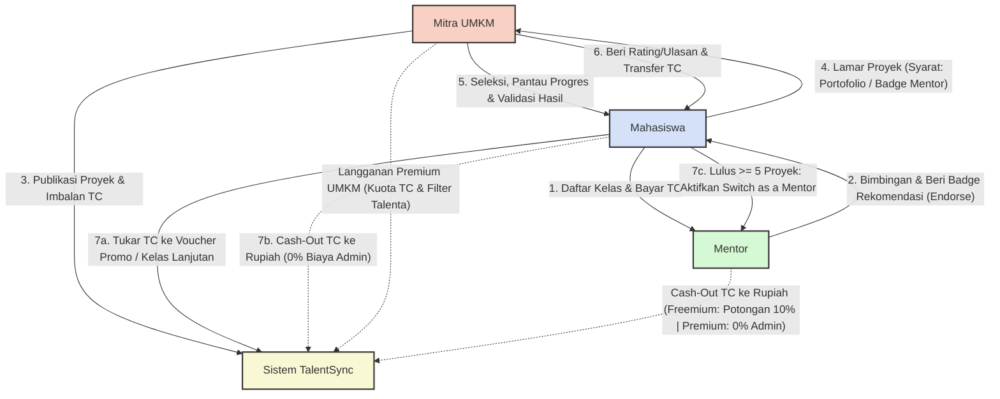

# Dokumentasi Arsitektur Bisnis & Ekosistem Aplikasi TalentSync
**Sistem:** Ekosistem Hybrid (Kredit Internal TimeCoin & Rupiah)  
**Entitas Pengguna:** Mahasiswa, Mitra UMKM, dan Mentor  
**Stack Teknologi:** Flutter (Mobile), Laravel (Backend RESTful API), PostgreSQL (Database)

---

## 1. Pengantar dan Konsep Utama
**TalentSync** dirancang sebagai aplikasi mobile kolaboratif yang menghubungkan **Mahasiswa**, **Mitra UMKM**, dan **Mentor** dalam satu ekosistem digital terpadu. Konsep aplikasi ini dibangun di atas tiga pilar utama: **Belajar (Mentoring)**, **Mengerjakan Proyek Nyata (Project Execution)**, dan **Membangun Reputasi (Portofolio & Endorsement)**.

### Konsep Ekosistem Hybrid (TimeCoin & Rupiah)
Aplikasi mengusung konsep **Ekosistem Hybrid** yang menggabungkan kegiatan pembelajaran dan pelaksanaan proyek melalui dua mekanisme nilai yang berbeda:
1. **TimeCoin (TC) — Kredit Internal Aplikasi:**
   Digunakan untuk pencatatan nilai dan transaksi internal di dalam ekosistem TalentSync:
   * **Bagi Mahasiswa:** Digunakan untuk mendaftar kelas/sesi mentoring, diperoleh sebagai imbalan setelah menyelesaikan proyek UMKM, atau ditukarkan dengan *voucher promo/reward* di dalam aplikasi.
   * **Bagi Mitra UMKM:** Digunakan sebagai anggaran imbalan proyek atau apresiasi kepada mahasiswa berdasarkan kesepakatan tugas.
   * **Bagi Mentor:** Diterima sebagai kredit atas kegiatan bimbingan/kelas mentoring yang diselenggarakan.
2. **Rupiah (IDR) — Satuan Nilai Pembayaran Eksternal:**
   Digunakan untuk transaksi di luar mekanisme kredit internal (apabila fitur pembayaran dan pencairan diaktifkan), meliputi:
   * Pembelian paket layanan **Langganan Premium** (bagi UMKM dan Mentor).
   * **Top-Up TimeCoin** sebagai modal awal mengikuti kelas mentoring.
   * **Pencairan (*Cash-Out*) TimeCoin ke Rupiah** ke rekening bank (dengan estimasi nilai konversi pada rancangan antarmuka: `1 TC = Rp1.000`).

> **Catatan Implementasi Tahap Awal:** Pada tahap pengembangan awal (MVP akademik), TimeCoin diperlakukan sebagai kredit internal aplikasi dengan validasi saldo dan riwayat transaksi penuh di sisi server (*backend*), bukan sebagai uang elektronik umum secara otomatis.

---

## 2. Arsitektur Interaksi Antarperan & Alur Kerja Ekosistem

Berikut adalah representasi visual dari interaksi tiga peran utama beserta perputaran **TimeCoin (TC)** dan **Rupiah** berdasarkan rancangan *User Flow* dan *Activity Diagram* sistem:

### Tiga Pilar Interaksi Antarperan
1. **Interaksi Mahasiswa dan UMKM:**
   * UMKM memublikasikan proyek beserta deskripsi tugas, kategori, tenggat waktu, dan imbalan TimeCoin.
   * Mahasiswa melamar proyek dengan syarat wajib memiliki **Tautan Portofolio Eksternal** atau **Badge Rekomendasi dari Mentor**.
   * UMKM menyeleksi kandidat berdasarkan *Project History*, portofolio, dan *Badge* dari Mentor.
   * Mahasiswa mengerjakan proyek dan memperbarui progres melalui **Project Management** & **Activity Tracker**.
   * UMKM memeriksa hasil kerja (*deliverable*), meminta revisi jika belum sesuai, atau memvalidasi hasil akhir disertai pemberian *rating*, ulasan, dan transfer TimeCoin. Proyek otomatis tercatat di **Project History** mahasiswa.
2. **Interaksi Mahasiswa dan Mentor:**
   * Mentor membuka kelas bimbingan lengkap dengan topik, jadwal, tautan *video call*, dan tarif TimeCoin.
   * Mahasiswa mendaftar kelas menggunakan saldo TimeCoin.
   * Selama/setelah kelas, Mentor mengevaluasi tugas peserta dan dapat memberikan **Badge Rekomendasi Kerja (*Endorsement*)** kepada mahasiswa yang kompeten sebagai modal melamar proyek UMKM.
3. **Interaksi Mentor dan UMKM:**
   * Mentor membantu menyiapkan kesiapan keterampilan mahasiswa sesuai kebutuhan proyek UMKM.
   * Melalui fitur **Talent Recommendation** dan **Endorsement Murid**, mentor menjembatani UMKM dalam menemukan kandidat mahasiswa yang sudah tervalidasi keahliannya.

---

## 3. Peran, Hak Akses, dan Fitur *Switch as a Mentor*

Sistem membagi pengguna ke dalam tiga peran utama dengan mekanisme verifikasi dan hak akses yang terstruktur:

### 1. Mahasiswa
* **Verifikasi:** Menggunakan bukti identitas akademik yang valid seperti **Kartu Tanda Mahasiswa (KTM)**.
* **Hak Akses & Fungsi Utama:**
  * Membuat dan mengelola profil serta galeri portofolio.
  * Menjelajahi, mencari, dan melamar proyek UMKM.
  * Memperbarui progres tugas pada *Project Management* & *Activity Tracker* serta mengunggah hasil pekerjaan (*deliverable*).
  * Mengikuti kelas atau sesi mentoring dan menerima *Badge Rekomendasi* dari Mentor.
  * Menerima penilaian/ulasan serta imbalan TimeCoin dari UMKM ke dalam *Project History*.
  * Mengelola dompet TimeCoin (riwayat transaksi, penukaran voucher promo, atau pencairan).

### 2. Mitra UMKM
* **Verifikasi:** Menggunakan informasi usaha dan bukti pendukung yang relevan.
* **Hak Akses & Fungsi Utama:**
  * Membuat dan mengelola profil usaha.
  * Memublikasikan proyek beserta deskripsi, keahlian yang dibutuhkan, tenggat waktu, dan imbalan TimeCoin.
  * Meninjau profil, *Project History*, portofolio, dan *Badge Rekomendasi* calon pelaksana.
  * Mengaktifkan *Filter Talenta* (khusus Premium) untuk menyaring kandidat bergelar *Badge Rekomendasi Mentor*.
  * Memantau status pengerjaan proyek (dibuka, menunggu seleksi, berlangsung, revisi, selesai), mengunduh *deliverable*, dan memberikan penilaian akhir.

### 3. Mentor
* **Verifikasi:** Pemeriksaan informasi bidang keahlian dan bukti portofolio pendukung yang relevan.
* **Hak Akses & Fungsi Utama:**
  * Mengelola profil keahlian, membuat kelas/sesi mentoring, serta mengatur jadwal dan biaya TimeCoin.
  * Mengelola daftar murid, membagikan tautan sesi bimbingan (*video call*), dan memeriksa tugas peserta.
  * Memberikan evaluasi serta **Badge Rekomendasi Kerja (*Endorse*)** kepada mahasiswa agar direkomendasikan ke UMKM.
  * Melihat riwayat kelas dan mengelola pencairan (*Cash-Out*) saldo TimeCoin.

### Fitur *Switch as a Mentor* (Mahasiswa Menjadi Mentor)
Mahasiswa yang memiliki kompetensi unggul dapat mengajukan diri menjadi mentor melalui fitur **Switch as a Mentor** pada halaman Profil:
* **Syarat Aktivasi:** Mahasiswa telah menyelesaikan minimal **5 proyek UMKM** dengan *rating* dan tingkat penyelesaian yang baik, serta melengkapi bidang keahlian dan portofolio pendukung.
* **Mekanisme:** Saat tombol *toggle* **Mode Mentor** diaktifkan dan disetujui sistem, mahasiswa mendapatkan akses ke fitur pengelolaan kelas untuk mulai mengajar mahasiswa lain dan memperoleh TimeCoin yang dapat dicairkan ke Rupiah.

---

## 4. Skema Distribusi Awal TimeCoin (Onboarding)

Setiap perubahan saldo TimeCoin harus divalidasi oleh server dan tercatat di dalam tabel `TimeCoin Wallets` serta `TimeCoin Transactions` (mencakup sumber transaksi, tujuan, jumlah kredit, waktu, dan status).

| Entitas Pengguna | Skema Saldo Awal | Ketentuan & Mekanisme Perolehan |
| :--- | :---: | :--- |
| **Mahasiswa** | **0 TC** *(atau Bonus Sambutan)* | Bonus sambutan hanya diberikan apabila kebijakan *onboarding* verifikasi KTM diterapkan. Mahasiswa memperoleh TC utama dari penyelesaian proyek UMKM (atau melalui *Top-Up* TC untuk modal kelas). |
| **Mitra UMKM** | **Hingga 20 TC / bulan** | Kuota dasar (*Freemium*) untuk memublikasikan proyek, dibatasi berdasarkan periode bulanan dan aturan penggunaan. Dapat ditingkatkan melalui paket Premium (misal hingga 500 TC/bulan). |
| **Mentor** | **0 TC** | Saldo awal mutlak nol. Kredit TimeCoin diperoleh secara organik dari mahasiswa yang mendaftar pada aktivitas kelas/mentoring. |

---

## 5. Rencana Model Monetisasi (Pendekatan Freemium)

Model bisnis TalentSync dirancang menggunakan pendekatan **Freemium** untuk menjaga aksesibilitas bagi mahasiswa sekaligus memberikan nilai tambah bagi Mitra UMKM dan Mentor.

### A. Mitra UMKM
* **Freemium (Dasar):** Mendapatkan kuota dasar hingga **20 TC per bulan** untuk memublikasikan proyek dengan batas penggunaan standar.
* **Premium (Berlangganan):**
  * Memperoleh kuota TimeCoin bulanan tambahan yang jauh lebih besar (contoh: hingga **500 TC**).
  * Fitur **undangan langsung (*direct invite*)** kepada mahasiswa.
  * Akses **Filter Talenta & Rekomendasi Mentor** (hanya menerima atau memprioritaskan mahasiswa yang memiliki *Badge Rekomendasi Mentor*).

### B. Mentor
* **Freemium (Dasar):** Dapat membuka kelas dan menggunakan fitur mentoring dasar. Apabila melakukan pencairan (*Cash-Out*) TimeCoin ke Rupiah, dikenakan **potongan biaya layanan/administrasi** (contoh pada rancangan antarmuka: **10%**).
* **Premium (Berlangganan):**
  * Peningkatan visibilitas profil mentor pada pencarian kelas.
  * Kuota pemberian rekomendasi talenta (*endorsement*) yang lebih besar.
  * **Bebas Biaya Admin (Potongan 0%)** saat melakukan pencairan (*Cash-Out*) TimeCoin ke rekening bank sehingga mentor menerima nilai penuh.

### C. Mahasiswa (100% Bebas Biaya)
* **Tanpa Biaya Berlangganan:** Mahasiswa dapat mengakses seluruh fitur utama (eksplorasi proyek, portofolio, *Project History*, *Activity Tracker*, dan pendaftaran mentoring) secara gratis untuk menghilangkan hambatan dalam membangun karier.
* **Keistimewaan *Cash-Out* 0% Admin:** Apabila fitur pencairan diterapkan, mahasiswa berhak mencairkan (*Cash-Out*) TimeCoin hasil pengerjaan proyek ke Rupiah **secara gratis (0% potongan biaya administrasi)** agar imbalan kerja mereka diterima secara utuh.

---

## 6. Ringkasan 12 Fitur Utama Sistem (Matriks IPO)

Seluruh ekosistem di atas didukung oleh 12 modul fungsional utama dalam perancangan sistem:
1. **Registrasi dan Login:** Validasi data akun multi-peran beserta verifikasi identitas (KTM/Usaha/Portofolio).
2. **Profil Pengguna:** Pengelolaan data diri, keahlian, statistik proyek selesai, *rating*, dan galeri portofolio.
3. **Pencarian Proyek:** Eksplorasi proyek UMKM berdasarkan kata kunci atau kategori.
4. **Pengajuan Proyek:** Pengiriman lamaran proyek dengan validasi syarat portofolio eksternal atau *Badge Rekomendasi Mentor*.
5. **Project Management:** Pengelolaan siklus proyek (*dibuka, menunggu seleksi, berlangsung, revisi, selesai*) dan pengunggahan *deliverable*.
6. **Project History:** Penyimpanan otomatis riwayat proyek yang telah selesai sebagai portofolio terverifikasi.
7. **Mentoring dan Kelas:** Pengelolaan jadwal kelas, tarif TimeCoin, tautan *video call*, dan evaluasi tugas murid.
8. **TimeCoin Wallet & Transactions:** Validasi kecukupan saldo di sisi server, transfer imbalan proyek, pembayaran kelas, penukaran voucher, dan riwayat mutasi TC.
9. **Talent Recommendation & Endorsement:** Pencocokan keahlian mahasiswa dengan kebutuhan proyek UMKM serta pemberian *Badge Rekomendasi Kerja* oleh Mentor.
10. **Ulasan & Rating:** Pemberian *rating* bintang dan komentar evaluasi setelah proyek atau sesi mentoring selesai.
11. **Switch as a Mentor:** Pemeriksaan persyaratan pengalaman proyek (minimal 5 proyek selesai) untuk membuka akses fitur mentor bagi mahasiswa.
12. **Activity Tracker:** Pencatatan detail aktivitas, status tugas, dan ringkasan perkembangan pengerjaan proyek.
