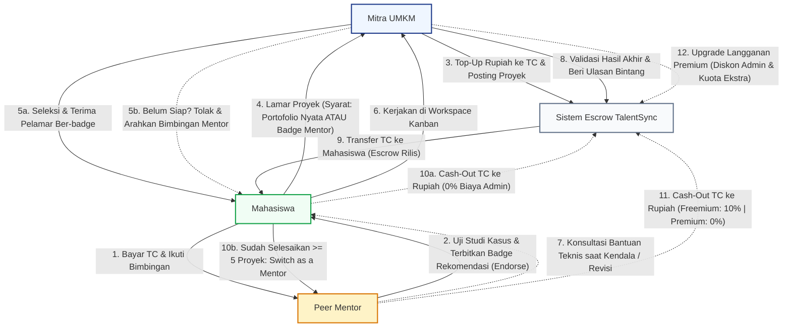

# Dokumentasi Arsitektur Bisnis & Ekosistem Aplikasi TalentSync
**Sistem:** Ekosistem Segitiga Hybrid (Kredit Internal TimeCoin & Rupiah)  
**Entitas Pengguna:** Mahasiswa, Mitra UMKM, dan Mentor (Peer Mentor / Senior)  
**Stack Teknologi:** Flutter (Mobile), Laravel (Backend RESTful API), PostgreSQL (Database)  
**Dokumen Rujukan:** Proposal Proyek TalentSync (S1 Sistem Informasi, Fakultas Teknik, UNESA 2026)  

---

## 1. Pengantar dan Konsep Utama

**TalentSync** adalah platform kolaborasi terpadu berbasis *mobile* yang menghubungkan **Mahasiswa**, **Mitra UMKM**, dan **Mentor** dalam satu ekosistem digital yang saling menguntungkan (*triangular ecosystem*).

Aplikasi ini mengatasi problem fundamental dalam dunia kerja mahasiswa dan digitalisasi UMKM:
* **Problem UMKM:** UMKM membutuhkan bantuan digitalisasi (aplikasi kasir, website, desain kemasan, pembukuan digital), tetapi ragu/takut mempekerjakan mahasiswa karena belum mengetahui kualitas aslinya (*unverified quality* & risiko hasil kerja terbengkalai).
* **Problem Mahasiswa:** Mahasiswa membutuhkan pengalaman proyek nyata dan penghasilan tambahan, namun sering ditolak karena belum memiliki portofolio kerja profesional.
* **Solusi TalentSync:** Menghadirkan **Mentor sebagai Kurator & Penjamin Kualitas (Quality Assurance)** yang membimbing mahasiswa, menguji kompetensi, dan menerbitkan **Badge Rekomendasi Kerja (*Endorsement*)** sehingga UMKM merasa aman dan yakin 100% saat mempekerjakan mahasiswa.

---

## 2. Arsitektur Ekosistem Segitiga (The Triangular Ecosystem)

Hubungan antara ketiga pihak digerakkan oleh perputaran **Kredit Internal TimeCoin (TC)** dan **Mata Uang Rupiah (IDR)** dengan rasio konversi referensi **1 TC $\approx$ Rp1.000**.

---

## 3. Detail Tiga Skenario Alur Interaksi Antarperan

### 🎯 Skenario 1: Penjamin Kualitas (Mentor ➔ Mahasiswa ➔ UMKM)
*Berdasarkan Dokumen Proposal Bab II & Wireframe Hal 15 (Quality Assurance Loop)*

1. **Mahasiswa Mengikuti Kelas / Sesi Konsultasi:**  
   Mahasiswa yang belum memiliki portofolio proyek nyata wajib mencari mentor terlebih dahulu di katalog bimbingan ([`FindMentorsScreen`](file:///c:/laragon/www/talentsync/flutter_frontend/lib/features/mentoring/screens/find_mentors_screen.dart)).
2. **Ujian & Penilaian Kompetensi:**  
   Mentor memberikan modul materi, latihan studi kasus, serta sesi tanya-jawab interaktif melalui *Live Video Call* atau obrolan chat. Mahasiswa mengunggah tugas di Ruang Belajar ([`RuangBelajarScreen`](file:///c:/laragon/www/talentsync/flutter_frontend/lib/features/mentoring/screens/ruang_belajar_screen.dart)).
3. **Penerbitan Badge Rekomendasi Kerja (*Endorse*):**  
   Jika mahasiswa lulus evaluasi dengan skor $\ge 80$, mentor menerbitkan sertifikat dan **Badge Rekomendasi Mentor** ([`MentoringResultScreen`](file:///c:/laragon/www/talentsync/flutter_frontend/lib/features/mentoring/screens/mentoring_result_screen.dart)).
4. **Melamar Proyek UMKM dengan Kredibilitas Tinggi:**  
   Ketika mahasiswa melamar pekerjaan di Mitra UMKM, profil lamaran menampilkan tanda centang hijau verifikasi: *"Direkomendasikan oleh Mentor Dimas Prasetyo (Senior Engineer)"*. UMKM mendapatkan kepastian mutu tanpa rasa ragu.

---

### 🛡️ Skenario 2: Seleksi, Penolakan Edukatif & Bantuan Revisi (UMKM ➔ Mahasiswa & Mentor)
1. **Penyaringan Pelamar oleh UMKM:**  
   Saat membuka lowongan proyek, UMKM meninjau pelamar.
2. **Aksi Edukatif — Tolak & Arahkan Bimbingan Mentor:**  
   Jika pelamar belum memiliki portofolio dan belum ber-badge mentor, UMKM menekan tombol **`Tolak & Arahkan Bimbingan Mentor`** pada layar seleksi ([`MsmeReviewApplicantsScreen`](file:///c:/laragon/www/talentsync/flutter_frontend/lib/features/msme/screens/msme_review_applicants_screen.dart)). Sistem memberikan notifikasi ramah dan tautan langsung agar mahasiswa mengambil mentoring terlebih dahulu untuk meningkatkan keahliannya.
3. **Pendampingan Teknis saat Revisi Proyek:**  
   Jika hasil kerja *deliverable* mahasiswa masih memiliki bug atau kekurangan desain, UMKM mengajukan catatan revisi dengan opsi **"Sarankan Konsultasi dengan Mentor Pendamping"** ([`MsmeReviewSubmissionScreen`](file:///c:/laragon/www/talentsync/flutter_frontend/lib/features/msme/screens/msme_review_submission_screen.dart)). Mahasiswa di Workspace Kanban dapat langsung menekan tombol **`Konsultasi Mentor`** untuk berdiskusi 1-on-1 dengan mentor guna menyelesaikan revisi tepat waktu.

---

### 💼 Skenario 3: Pertumbuhan Mahasiswa Menjadi Mentor (*Switch as a Mentor*)
1. **Akumulasi Portofolio Nyata:**  
   Mahasiswa mengerjakan tugas-tugas dari berbagai UMKM (misal kasir digital, branding kemasan, katalog online).
2. **Syarat Kelulusan $\ge 5$ Proyek:**  
   Setelah mahasiswa berhasil menyelesaikan minimal **5 proyek UMKM terverifikasi** dengan rating bintang yang baik, sistem secara otomatis mengaktifkan fitur toggle **Mode Mentor** pada profil mahasiswa ([`SwitchToMentorScreen`](file:///c:/laragon/www/talentsync/flutter_frontend/lib/features/profile/screens/switch_to_mentor_screen.dart)).
3. **Mulai Membimbing Mahasiswa Junior:**  
   Mahasiswa naik level menjadi *Peer Mentor* (mahasiswa senior/praktisi muda), membuka kelas bimbingan bertarif TC, dan membantu membimbing adik tingkatnya agar siap bekerja pada proyek UMKM berikutnya.

---

## 4. Arsitektur Finansial & Perputaran TimeCoin (TC)

TalentSync menerapkan sistem moneter internal yang transparan dan adil bagi seluruh pihak:

| Peran | Sumber Perolehan Nilai | Penggunaan Nilai | Kebijakan Pencairan (*Cash-Out*) & Admin |
|---|---|---|---|
| **Mahasiswa** | Imbalan penyelesaian proyek UMKM (dibayarkan via TC). Dapat juga melakukan Top-Up TC mandiri untuk modal bimbingan. | Digunakan untuk booking sesi konsultasi/mentoring atau penukaran voucher reward. | **0% Biaya Potongan Admin:** Mahasiswa berhak mencairkan TC hasil kerja proyek ke rekening bank Rupiah secara utuh ($1\text{ TC} = \text{Rp}1.000$) tanpa potongan sepeser pun. |
| **Mitra UMKM** | Kuota dasar bulanan (20 TC/bulan) atau membeli TC melalui fitur **Top-Up TimeCoin via Rupiah**. | Digunakan untuk mendanai imbalan proyek (*escrow*) kepada mahasiswa pelaksana. | **Model Langganan Premium:** UMKM dapat berlangganan paket Premium untuk mendapatkan kuota ekstra hingga 500 TC/bulan, bebas biaya administrasi saat top-up, dan akses filter prioritas pelamar ber-badge mentor. |
| **Mentor** | Menerima transfer TC dari mahasiswa yang memesan kelas bimbingan / konsultasi 1-on-1. | Mengembangkan reputasi, menambah saldo dompet, atau dicairkan ke Rupiah. | **Freemium vs Premium:** • *Akun Mentor Freemium:* Pencairan TC ke Rupiah dikenakan potongan admin **10%**. • *Akun Mentor Premium:* Bebas biaya admin (**0% potongan**) sehingga mentor menerima pencairan utuh. |

---

## 5. Peta Aksesibilitas Konsultasi & Mentoring di POV Mahasiswa

Untuk memastikan mahasiswa tidak kebingungan mencari modul bimbingan/konsultasi, TalentSync menyediakan **4 titik akses navigasi strategis**:

1. **Dashboard Utama Mahasiswa ([`DashboardMahasiswaScreen`](file:///c:/laragon/www/talentsync/flutter_frontend/lib/features/dashboard/screens/dashboard_mahasiswa_screen.dart)):**
   * Seksi dedicated **"Konsultasi & Bimbingan"** dengan kartu mentor aktif, ringkasan jadwal live consultation, tombol *Jadwal Saya*, tombol *Masuk Sesi*, dan tautan *Cari mentor*.
2. **Papan Kerja Proyek ([`WorkspaceKanbanScreen`](file:///c:/laragon/www/talentsync/flutter_frontend/lib/features/workspace/screens/workspace_kanban_screen.dart)):**
   * Banner bantuan teknis **"Mengalami Kendala Teknis Proyek?"** tepat di bawah kolom Kanban, menghubungkan mahasiswa langsung ke direktori peer mentor untuk sesi debugging.
3. **Form Pengumpulan Deliverable ([`SubmissionScreen`](file:///c:/laragon/www/talentsync/flutter_frontend/lib/features/workspace/screens/submission_screen.dart)):**
   * Banner verifikasi pra-pengumpulan **"Konsultasi Sebelum Mengumpulkan"** agar mahasiswa dapat berkonsultasi review kualitas dengan mentor sebelum hasil diserahkan ke UMKM.
4. **Pencarian Katalog Mentor ([`FindMentorsScreen`](file:///c:/laragon/www/talentsync/flutter_frontend/lib/features/mentoring/screens/find_mentors_screen.dart)):**
   * Akses filter kategori keahlian lengkap (Flutter, UI Design, Laravel, Machine Learning, Database) dengan informasi tarif TC, ulasan murid, dan rating bintang.

---

## 6. Standar Keamanan Sesi Akun & Logout Mahasiswa

Aplikasi menjamin kemudahan akses keluar akun (*Logout*) dengan perlindungan konfirmasi modal agar tidak terjadi ketidaksengajaan:
1. **Header Beranda:** Tombol ikon merah `Icons.logout_rounded` di pojok kanan atas berdampingan dengan ikon lonceng notifikasi.
2. **Header Profil Mahasiswa:** Tombol merah `Icons.logout_rounded` berdampingan dengan tombol gear pengaturan.
3. **Kartu Sesi Akun:** Kartu dedicated di bagian bawah layar profil (*"Sesi Akun Mahasiswa"*).
4. **Menu Pengaturan:** Menu *"Ganti Peran / Keluar Akun"* di [`StudentSettingsScreen`](file:///c:/laragon/www/talentsync/flutter_frontend/lib/features/profile/screens/student_settings_screen.dart).
5. **Menu Privasi & Keamanan:** Menu *"Keluar dari Akun"* di [`PrivacySecurityScreen`](file:///c:/laragon/www/talentsync/flutter_frontend/lib/features/profile/screens/privacy_security_screen.dart).
6. **Mekanisme Reset Stack:** Memanggil `Navigator.pushNamedAndRemoveUntil(context, AppRoutes.roleSelection, (route) => false)` sehingga seluruh sesi lama dibersihkan tuntas saat pengguna keluar.

---

## 7. Ringkasan 10 Layar Modul Mentoring Mahasiswa

| Layar | Rute Aplikasi | Deskripsi Fungsionalitas |
|---|---|---|
| [`FindMentorsScreen`](file:///c:/laragon/www/talentsync/flutter_frontend/lib/features/mentoring/screens/find_mentors_screen.dart) | `/mentors` | Eksplorasi daftar mentor, filter bidang keahlian, dan statistik rating |
| [`MentorProfileScreen`](file:///c:/laragon/www/talentsync/flutter_frontend/lib/features/mentoring/screens/mentor_profile_screen.dart) | `/mentors/profile` | Profil mendalam mentor, riwayat bimbingan, review murid, dan tombol booking |
| [`BookingSessionScreen`](file:///c:/laragon/www/talentsync/flutter_frontend/lib/features/mentoring/screens/booking_session_screen.dart) | `/mentors/booking` | Form pemilihan tanggal, jam bimbingan, topik konsultasi, & pembayaran TC |
| [`MentoringSessionScreen`](file:///c:/laragon/www/talentsync/flutter_frontend/lib/features/mentoring/screens/mentoring_session_screen.dart) | `/mentoring/session` | Ruang tatap muka Live Video Call bimbingan interaktif mahasiswa-mentor |
| [`MentorChatScreen`](file:///c:/laragon/www/talentsync/flutter_frontend/lib/features/mentoring/screens/mentor_chat_screen.dart) | `/mentors/chat` | Ruang obrolan pesan teks 1-on-1 dan pertukaran dokumen/kode bimbingan |
| [`RuangBelajarScreen`](file:///c:/laragon/www/talentsync/flutter_frontend/lib/features/mentoring/screens/ruang_belajar_screen.dart) | `/mentoring/ruang-belajar` | Ruang pengerjaan tugas & studi kasus yang diarahkan mentor |
| [`MyMentorsScreen`](file:///c:/laragon/www/talentsync/flutter_frontend/lib/features/mentoring/screens/my_mentors_screen.dart) | `/mentors/my-mentors` | Jadwal bimbingan aktif, daftar mentor terhubung, dan riwayat sesi |
| [`LogBimbinganScreen`](file:///c:/laragon/www/talentsync/flutter_frontend/lib/features/mentoring/screens/log_bimbingan_screen.dart) | `/mentoring/log` | Catatan evaluasi, saran perbaikan, dan rangkuman poin per sesi |
| [`MentoringResultScreen`](file:///c:/laragon/www/talentsync/flutter_frontend/lib/features/mentoring/screens/mentoring_result_screen.dart) | `/mentoring/result` | Lembar hasil bimbingan, nilai akhir, & penerbitan Badge Rekomendasi Kerja |
| [`SelesaiBimbinganScreen`](file:///c:/laragon/www/talentsync/flutter_frontend/lib/features/mentoring/screens/selesai_bimbingan_screen.dart) | `/mentoring/selesai` | Penutupan sesi bimbingan, pemberian ulasan bintang, dan feedback ke mentor |
