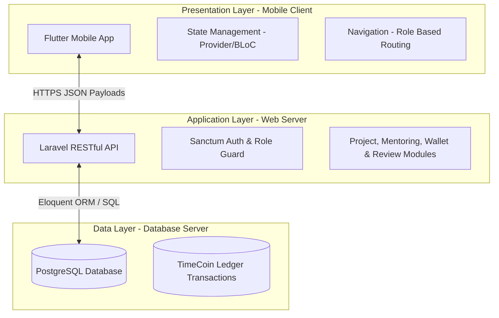
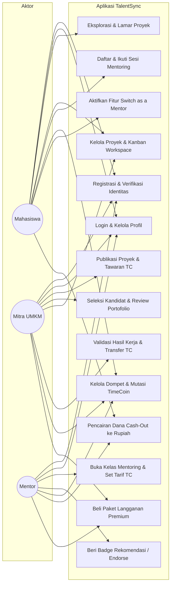
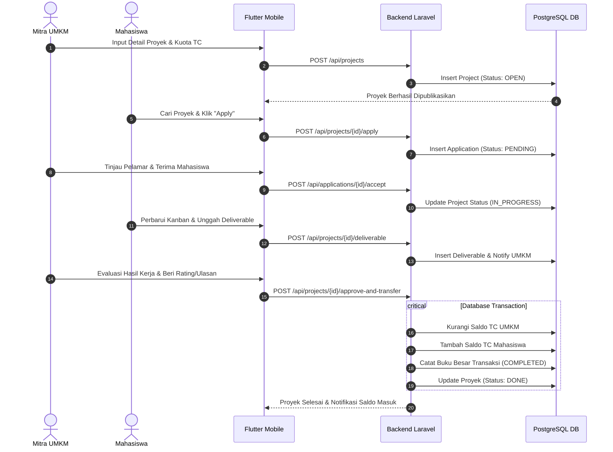

# Dokumen Perancangan Sistem & Arsitektur Teknologi
**Aplikasi:** TalentSync — Platform Kolaborasi Mahasiswa, UMKM, dan Mentor  
**Mata Kuliah:** Pemrograman Aplikasi Bergerak (Kelas 2024A)  
**Program Studi:** S1 Sistem Informasi, Fakultas Teknik, Universitas Negeri Surabaya (2026)  

---

## 1. Arsitektur Sistem Global

TalentSync menerapkan arsitektur **Client-Server 3-Tier** yang memisahkan antara antarmuka pengguna, logika bisnis, dan persistensi data guna menjamin skalabilitas, modularitas, dan keamanan sistem.

### Penjelasan Lapisan Arsitektur:
1. **Presentation Layer (Flutter Mobile App):**
   - Berfungsi sebagai antarmuka pengguna interaktif pada perangkat Android.
   - Menggunakan Flutter dengan bahasa Dart, menerapkan **Feature-First Architecture** dan state management terstruktur.
2. **Application Layer (Laravel RESTful API):**
   - Berfungsi sebagai pusat logika bisnis, validasi aturan aplikasi, manajemen hak akses (*Role & Permissions*), pemrosesan transaksi kredit TimeCoin, serta penyedia endpoint RESTful API terstandar JSON.
3. **Data Layer (PostgreSQL Database):**
   - Berfungsi sebagai penyimpanan data relasional terpusat yang menjamin integritas data (ACID) untuk akun pengguna, status proyek, berkas pekerjaan, ulasan, dan buku besar transaksi TimeCoin.

---

## 2. Lima Pilar Arsitektur Teknis Flutter

Sesuai standar rekayasa perangkat lunak aplikasi bergerak, implementasi sisi Flutter dibangun di atas lima fondasi teknis:

1. **Pembuatan Struktur dan Arsitektur Antarmuka (UI):**
   - Tata letak berlapis dirender menggunakan hierarki sumbu Z (`Stack` dan `Positioned`) untuk kartu profil melayang, *custom bottom navigation bar*, dan *floating action button*.
   - Pemuatan data berkapasitas besar dioptimalkan menggunakan widget *infinite scrolling* (`ListView.builder` dan `GridView.builder`) guna menghemat konsumsi memori perangkat.
2. **Manajemen Rute dan Navigasi:**
   - Menerapkan navigasi berbasis peran pengguna menggunakan rute terstruktur (`AppRoutes` / `go_router`).
   - Menerapkan *ShellRoute* / *persistent shell* agar riwayat navigasi dan status setiap tab menu bawah (*Home, Search, Mentors, Wallet, Profile*) tetap terjaga saat berganti antarhalaman.
3. **Manajemen Status (State Management):**
   - Memisahkan logika tampilan UI secara absolut dari logika bisnis menggunakan **Provider / BLoC**.
   - Mengelola sinkronisasi data dari pemanggilan RESTful API, keranjang pendaftaran kelas, dan saldo dompet TimeCoin secara *reactive*.
4. **Keamanan Formulir dan Validasi Input:**
   - Setiap masukan teks diamankan dengan kombinasi `inputFormatters` untuk menyaring karakter ilegal atau injeksi sejak dini.
   - Menerapkan *Strategy Pattern* pada validator formulir untuk memeriksa format email institusi, batas panjang karakter, kelayakan tautan portofolio, dan validasi nominal TimeCoin.
5. **Mitigasi Siklus Hidup dan Penanganan Kesalahan (Lifecycle & Error Handling):**
   - Memanfaatkan `AppLifecycleListener` / `WidgetsBindingObserver` untuk menyimpan draf pengerjaan proyek ke penyimpanan lokal secara otomatis saat aplikasi memasuki status *Inactive* atau *Paused*, mencegah hilangnya data akibat *process death*.
   - Penanganan status jaringan, indikator *loading*, pesan peringatan ramah pengguna, dan *offline fallback*.

---

## 3. Matriks Input, Proses, dan Output (IPO) Fitur Utama

Berikut adalah matriks IPO untuk 12 fitur utama aplikasi TalentSync:

| No | Fitur | Input | Proses | Output |
|---|---|---|---|---|
| 1 | **Registrasi & Login** | Email, password, peran, dokumen identitas (KTM/usaha) | Validasi kredensial, hashing password, pembuatan access token | Akun terverifikasi, token sesi login |
| 2 | **Profil Pengguna** | Data diri, foto, bio, daftar keahlian, link portofolio | Penyimpanan dan pembaharuan data profil di basis data | Halaman profil dan kartu identitas publik |
| 3 | **Pencarian & Eksplorasi Proyek** | Kata kunci pencarian, filter kategori, rentang imbalan TC | Query filtering basis data dengan pencocokan parameter | Daftar kartu proyek yang relevan |
| 4 | **Pengajuan Proyek (Apply)** | ID proyek, surat lamaran singkat, tautan portofolio / badge | Pengecekan syarat pelamar, pencatatan lamaran di database | Status pengajuan: `Menunggu Seleksi` |
| 5 | **Project Management (Kanban)** | Status tugas (*To-Do*, *In-Progress*, *Review*, *Done*) | Pembaruan status aktivitas dan kalkulasi progres persentase | Papan Kanban proyek dan linimasa progres |
| 6 | **Project History** | Data penyelesaian proyek dari UMKM | Penguncian status akhir proyek dan pengarsipan riwayat | Riwayat proyek selesai pada profil mahasiswa |
| 7 | **Mentoring & Kelas** | Jadwal, topik keahlian, tautan video call, tarif TC | Publikasi sesi bimbingan oleh mentor, alokasi kuota murid | Daftar kelas terbuka dan detail pemesanan |
| 8 | **TimeCoin Ledger** | ID pengirim, ID penerima, jumlah TC, jenis transaksi | Validasi kecukupan saldo, eksekusi transaksi database ACID | Mutasi saldo dan riwayat transaksi kredit |
| 9 | **Talent Recommendation** | Kebutuhan keahlian proyek, riwayat proyek mahasiswa | Algoritma pencocokan kesesuaian keahlian (*skill match*) | Daftar rekomendasi mahasiswa kompeten |
| 10 | **Rating & Ulasan** | Nilai bintang (1-5), teks ulasan hasil kerja | Agregasi skor reputasi dan penautan ulasan ke profil | Skor rating rata-rata dan daftar testimoni |
| 11 | **Switch as a Mentor** | Bukti kelulusan $\ge 5$ proyek, keahlian khusus | Verifikasi rekam jejak penyelesaian proyek mahasiswa | Pengaktifan modul mentor pada akun mahasiswa |
| 12 | **Activity Tracker** | Catatan progres pengerjaan harian, lampiran berkas | Pencatatan riwayat aktivitas pengerjaan proyek | Log aktivitas real-time bagi UMKM & mahasiswa |

---

## 4. Pemodelan Sistem (System Modeling)

### 4.1 Use Case Diagram

### 4.2 Activity Diagram: Siklus Pengerjaan Proyek UMKM

---

## 5. Rancangan Basis Data Relasional (14 Entitas PostgreSQL)

Sistem dirancang menggunakan 14 tabel relasional berikut:

1. `users`: Menyimpan kredensial otentikasi utama (email, password hash, role aktif).
2. `roles`: Master peran pengguna (`student`, `umkm`, `mentor`, `admin`).
3. `student_profiles`: Profil mahasiswa, perguruan tinggi, program studi, status verifikasi KTM.
4. `umkm_profiles`: Profil pelaku usaha, nama usaha, sektor industri, verifikasi izin/dokumen usaha.
5. `mentor_profiles`: Profil keahlian mentor, jabatan, bio keahlian, status sertifikasi.
6. `projects`: Data proyek UMKM (judul, deskripsi, kategori, tenggat waktu, imbalan TC, status).
7. `project_applications`: Pendaftaran mahasiswa ke proyek (surat lamaran, lampiran, status seleksi).
8. `project_deliverables`: Hasil pengerjaan proyek (tautan berkas, ringkasan pekerjaan, tanggal serah).
9. `mentoring_classes`: Jadwal kelas mentor (topik, deskripsi, jadwal pelaksanaan, kuota, tarif TC).
10. `mentoring_enrollments`: Pendaftaran mahasiswa ke kelas mentor beserta status kehadiran.
11. `reviews`: Ulasan dan rating bintang antar entitas (UMKM ke Mahasiswa, Mahasiswa ke Mentor).
12. `portfolios`: Karya dan portofolio yang dipamerkan mahasiswa pada profil publik.
13. `time_coin_wallets`: Informasi saldo kredit internal pengguna saat ini.
14. `time_coin_transactions`: Buku besar audit transaksi (sumber, tujuan, kuota TC, tipe mutasi, timestamp).

---

## 6. Keamanan, Validasi, dan Integritas Sistem

1. **Autentikasi & Autorisasi:**
   - Otentikasi berbasis *Bearer Token* menggunakan Laravel Sanctum.
   - Pengecekan peran (*Role Guard Middleware*) di setiap rute API agar mahasiswa tidak dapat mengakses fitur publikasi proyek UMKM atau modul evaluasi mentor.
2. **Validasi Formulir & Sanitasi Input:**
   - Sisi Flutter: Menggunakan `inputFormatters` dan validator Regex untuk mencegah karakter terlarang (*anti XSS / Injection*).
   - Sisi Backend: Menggunakan *Form Request Validation* dengan aturan ketat untuk setiap payload data masuk.
3. **Integritas Transaksi Finansial Internal:**
   - Transaksi TimeCoin wajib menggunakan mekanisme *Database Locking* (`SELECT FOR UPDATE`) dan blok transaksi ACID (`DB::transaction`) untuk mencegah anomali *double-spending*.
   - Saldo dompet dihitung dari rekapitulasi buku besar transaksi yang tervalidasi.

---

## 7. Rencana Pengujian Sistem (Software Testing Plan)

Pengujian sistem dilakukan melalui 7 kategori evaluasi terstruktur:

| No | Jenis Pengujian | Tujuan & Skenario Uji | Kriteria Keberhasilan |
|---|---|---|---|
| 1 | **Functional Testing** | Memastikan semua fungsi bisnis (FR-01 s/d FR-12) seperti pendaftaran proyek, pemesanan sesi mentor, dan pembaharuan Kanban berjalan normal. | Semua alur use case menghasilkan output yang sesuai rancangan tanpa error eksekusi. |
| 2 | **UI & Responsive Testing** | Menguji tata letak antarmuka Flutter pada berbagai ukuran layar Android, konsistensi palet warna (`primaryTan`, `darkBrown`), dan responsivitas interaksi tombol solid. | Tampilan tidak mengalami *overflow*, navigasi mulus, kontras teks memenuhi standar ergonomis. |
| 3 | **API Testing** | Menguji semua endpoint RESTful API Laravel dengan berbagai parameter input (valid dan invalid) menggunakan Postman / Automated Test. | Endpoint mengembalikan status HTTP yang benar (200, 201, 400, 401, 403, 422) dengan format JSON standar. |
| 4 | **Validation Testing** | Menguji penanganan input ilegal seperti email tidak valid, karakter berbahaya, atau batas nominal negatif pada form transaksi. | Sistem menolak input tidak valid dan memunculkan pesan peringatan yang informatif tanpa crash. |
| 5 | **Role Access Testing** | Menguji pembatasan hak akses: Mahasiswa mencoba mengakses dashboard UMKM, atau UMKM mencoba membuka modul mengajar mentor. | Permintaan akses ditolak dengan respon *403 Forbidden* dan navigasi aplikasi kembali ke rute yang berhak. |
| 6 | **Transaction Testing** | Menguji transfer kredit TimeCoin secara simultan (*concurrency*) dan pengujian kondisi saldo tidak mencukupi saat memesan kelas. | Transaksi gagal jika saldo kurang; saldo tidak pernah bernilai minus; pencatatan mutasi akurat 100%. |
| 7 | **User Acceptance Testing (UAT)** | Menguji alur aplikasi langsung kepada perwakilan pengguna mahasiswa, pemilik UMKM, dan calon mentor. | Pengguna dapat menyelesaikan tugas (melamar proyek, menyetujui tugas, memesan kelas) dengan tingkat kepuasan tinggi. |

